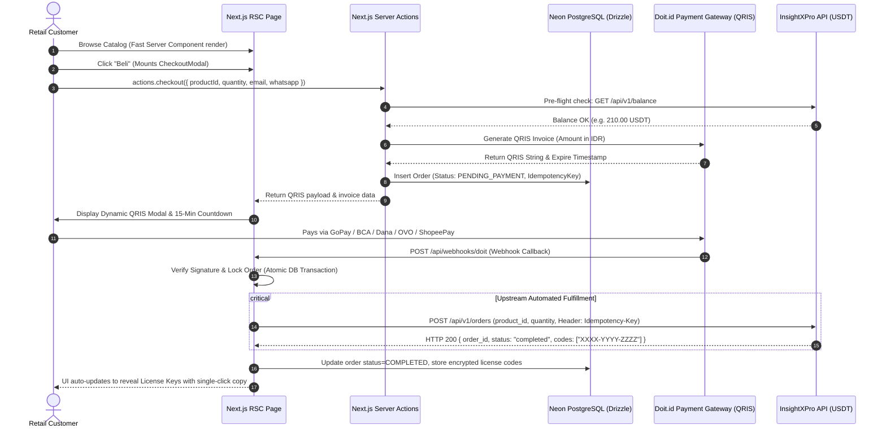

# Architecture & Technical Design - Pixel Store (Next.js App Router Edition)

## 1. System Overview & App Router Architecture

Pixel Store is built using **Next.js (App Router, Turbopack, React 19)**. It delivers a blazing fast, highly resilient e-commerce experience leveraging **React Server Components (RSC)** for server-side catalog data rendering and dedicated Client Components for interactive checkout, QRIS payment, customer portals, and real-time support chat.

```mermaid
flowchart TD
    subgraph ClientBrowser ["Client Browser"]
        ServerRenderedPage["RSC Catalog Page (src/app/page.tsx)"]
        InteractiveClientComponents["Client Components (StoreFront, CheckoutModal, SupportChat)"]
    end

    subgraph NextServer ["Next.js Server Process"]
        AppRouter["App Router Engine (src/app/)"]
        ServerActions["Next.js Server Actions ('use server' in src/app/actions.ts)"]
        WebhookRoutes["Route Handlers (src/app/api/webhooks/doit/route.ts)"]
        
        subgraph InternalServices ["Core Services"]
            FXService["FX & Margin Engine"]
            InsightClient["InsightXPro Wholesale Client"]
            RateLimiter["In-Memory Token Bucket"]
        end

        subgraph DatabaseLayer ["Data Layer"]
            PostgreSQL[(Neon PostgreSQL / Drizzle ORM)]
        end
    end

    subgraph ExternalThirdParties ["External Services"]
        PG["Doit.id Payment Gateway (QRIS & Direct Checkout)"]
        Upstream["InsightXPro API (USDT)"]
    end

    ServerRenderedPage -->|Rendered on Server| AppRouter
    InteractiveClientComponents -->|Invoke Action: checkout()| ServerActions
    ServerActions --> FXService
    ServerActions --> PG
    ServerActions --> PostgreSQL

    PG -->|Webhook Callback| WebhookRoutes
    WebhookRoutes -->|Verify & Lock Order| PostgreSQL
    WebhookRoutes -->|POST /api/v1/orders| InsightClient
    InsightClient --> Upstream
    InsightClient -->|Receive License Keys| WebhookRoutes
    WebhookRoutes -->|Update Order to COMPLETED| PostgreSQL
```

---

## 2. End-to-End Sequence Diagram



---

## 3. Technology Stack Decisions

| Layer | Selection | Justification & Performance Impact |
| :--- | :--- | :--- |
| **Core Framework** | **Next.js (App Router)** | Modern full-stack architecture with React Server Components, zero boilerplate, and Turbopack. |
| **Component Architecture** | **React 19 (Server & Client Components)** | Server-rendered pages (`src/app/page.tsx`, `user/page.tsx`, `support/page.tsx`, `admin/page.tsx`) with leaf client components. |
| **Language** | **TypeScript (Strict Mode)** | End-to-end type safety, standard `ActionResponse<T>`, zero `any`. |
| **Styling & UI Theme** | **Tailwind CSS v4 + PostCSS** | **Minimalist Clean Monochrome**: Pure monochrome black/white/zinc palette, stark contrast, clean borders, dense grid layout, zero artificial glow. |
| **Database & ORM** | **PostgreSQL + Drizzle ORM (`postgres.js`)** | Enterprise-grade ACID compliance, connection pooling, and multi-user concurrency on Neon PostgreSQL. |
| **Authentication & Accounts** | **Neon Managed Better Auth (`@neondatabase/auth`)** | Managed Better Auth built on Neon backend with branch-isolated auth state, `neon_auth` PostgreSQL schema, cookie encryption, and dual-layer sync to local customer accounts. |
| **Server Mutations** | **Next.js Server Actions (`src/app/actions.ts`)** | Type-safe Server Actions returning `{ success, data, error }` with async cookies and Zod validation. |
| **API Webhooks** | **Route Handlers (`src/app/api/webhooks/doit/route.ts`)** | Dedicated Route Handlers for external payment gateway webhooks. |

---

## 4. Key Architectural Patterns

### 4.1 Server Components & Leaf Client Interactivity
- Root layout and page entries are Server Components that fetch initial store configurations and products.
- Interactive drawers, modals, search bars, and live chats are marked with `'use client'` at the leaf component level.

### 4.2 PostgreSQL Database & Account Architecture
- Scalable, reliable PostgreSQL cluster connection via `postgres.js` with SSL support (`sslmode=require`) and connection pooling.
- Auto-initialization on startup (`ensureDatabaseTables`) creates all required schemas (`app_settings`, `users`, `user_sessions`, `products_cache`, `orders`, `payments`, `support_conversations`, `support_messages`) and performance indexes without downtime.
- Hybrid Checkout Model: Supports friction-free Guest Checkout while automatically associating orders to registered User Accounts (`orders.user_id`) when logged in.

### 4.3 Resilience & Upstream Safeguards
1. **Idempotency Guarantee**: `Idempotency-Key` (UUIDv4) is generated at order creation and reused for every call to InsightXPro `POST /api/v1/orders`.
2. **Atomic Lock (Compare-and-Swap)**: Prevents race conditions between concurrent webhooks and client polling.
3. **Pre-flight Balance Check**: Every checkout attempt checks `GET /api/v1/balance` before issuing a QRIS code.

### 4.4 Neon Managed Better Auth Architecture
- **Managed Auth Proxy**: `/api/auth/[...path]` route handler automatically proxies Better Auth requests using `auth.handler()` from `@neondatabase/auth/next/server`.
- **Database Branching Compatibility**: Auth user state lives directly in Neon's `neon_auth` PostgreSQL schema, branching automatically with database branches in preview/staging/production environments.
- **Client & Server SDK**: Server components and Server Actions interact via `createNeonAuth` (`src/lib/auth/server.ts`), while client components interact via `createAuthClient` (`src/lib/auth/client.ts`).
- **Resilient Fallback & Synchronization**: User registration/login in Server Actions coordinates upstream Neon Better Auth (`auth.signUp.email`, `auth.signIn.email`) while synchronizing local customer account records in `users` to guarantee order FK integrity and continuous uptime.

### 4.5 Better Auth Admin Dashboard Access & Plugin Architecture
- **Mandatory Account Registration**: Access to `/admin` dashboard requires an authenticated account registered via Better Auth (`email` & `password`) with `role: 'admin'`.
- **Better Auth Admin Plugin**: Neon SDK natively exposes Admin plugin methods (`auth.admin.createUser`, `auth.admin.setRole`, `auth.admin.listUsers`, `auth.admin.banUser`).
- **Owner Bootstrap & Role Assignment**: Initial admin registration requires Master Secret PIN authorization (`adminKey`) to prevent unauthorized public admin registration, or assigning admin role via Neon Console (**Auth → Users → Make admin**).
- **In-App Role Management**: Dashboard `/admin/users` allows active administrators to promote customer accounts to admin or revoke admin privileges via `adminSetUserRole`.

### 4.6 Better Auth Google OAuth Integration
- **Social Sign-In Protocol**: Triggered via `authClient.signIn.social({ provider: 'google', callbackURL })`. Neon Managed Better Auth handles the OAuth handshake through shared credentials in development, redirecting to `{NEON_AUTH_BASE_URL}/callback/google` and returning to the application `callbackURL`.
- **Relational Integrity Auto-Sync**: When an OAuth user arrives, `getEffectiveUser()` and `syncNeonOAuthUser()` lazily insert/map the profile into the local PostgreSQL `users` table (`role: 'customer' | 'admin'`). This ensures foreign key constraints on `orders.user_id` and `support_conversations.user_id` are consistently satisfied.
- **Universal Multi-Touchpoint Support**: Integrated into Storefront modal (`UserAccountModal`), Customer Dashboard (`/user`), and Administrator Portal (`/admin/login`) with Clean Minimalist UI styling.


